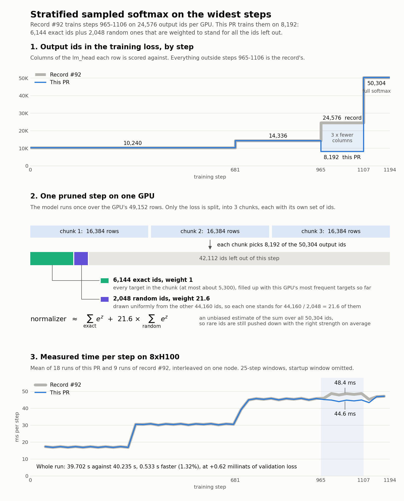

# NanoGPT speedrun: record attempt (stratified sampled softmax on the widest steps)

GPT-2 (124M-class) on FineWeb10B, 8xH100-80GB single node, gate: final val CE <= 3.28, mean over runs,
all runs count. Based on record #92 (ANVIL2, PR #360, commit `4ea6b93`). One change: the training loss of steps
965-1106.

> **Pool attached.** 18 runs of this tree interleaved with 9 runs of record #92 on the same machine in
> the same session, every run counted. **39.702 +/- 0.042 s** at mean val CE **3.27670 +/- 0.00114**,
> against 40.235 +/- 0.017 s for the record on that machine: **0.533 s faster (1.32%)**. The gate holds
> with one-sided p = 3.5e-10. Logs in `this_pr/` and `baseline/`.



## Result

| | runs | wall (training section) | final val CE |
|---|---|---|---|
| **this PR** | **18** | **39.702 +/- 0.042 s** | **3.27670 +/- 0.00114** |
| record #92 (same node, interleaved) | 9 | 40.235 +/- 0.017 s | 3.27608 +/- 0.00136 |
| **win** | | **0.533 s (1.32%)** | +0.62 millinats |

- Rule 2, one-sided t against the 3.28 gate: t = -12.3, p = 3.5e-10 (17 dof). The pool mean is
  3.3 millinats under the gate.
- Rule 4, one-sided Welch test that this PR is faster: p = 1.3e-25. Every run of this PR
  (39.659-39.809 s) is faster than every baseline run (40.200-40.257 s).
- The saving is where the change is: steps 950-1100 take 6.699 s here and 7.200 s in the record
  (a pruned step takes 44.6 ms against 48.4 ms); the other 1044 steps differ by 0.04 s.
- Val CE against the same-node baseline: +0.62 millinats, standard error about 0.5.
- Record #92 is 39.914 +/- 0.120 s as published. Measured here, same session, same machine:
  40.235 s (n = 9). This PR is below both.
- Peak memory is unchanged: 48,411 MiB allocated in both pools.
- `python records/track_1_short/2026-11-15_StratifiedSoftmaxTail/pool_statistics.py` recomputes all of
  the above from the logs (needs scipy).

Machine: Nebius `gpu-h100-sxm`, 8x H100 80GB HBM3, driver 580.173.02, the root `Dockerfile` unchanged
(torch 2.10.0+cu128, CUDA 13.1 runtime), 2026-11-16.

## The change

Record #92 trains steps 0-1106 on a sampled softmax and widens the candidate set as it goes. Its
widest setting, 24,576 ids, covers steps 965-1106. This PR runs those 142 steps on 8,192 columns.
The other steps, the schedule, the optimizer, the data and the validation are the record's.

On those steps each GPU's 49,152-row microbatch is split into 3 chunks of 16,384 rows **for the loss
only**; the model still runs once over the whole microbatch. Each chunk gets its own set:

| Part | Ids | Weight |
| --- | --- | --- |
| Exact | 6,144: every target in the chunk, filled up with the ids this GPU has seen most often as targets so far in the run | 1 |
| Tail | 2,048 drawn uniformly, without replacement, from all the remaining ids | (remaining ids) / 2,048, about 21.6 |

The loss normalizes over `sum_exact exp(z) + w * sum_tail exp(z)`, an unbiased estimate of the
full-vocabulary normalizer. A plain narrower set would never show most rare ids as wrong answers, and
their scores would drift up; here every id is still pushed down with the right strength on average.
The CE kernel is the record's with one log weight per column added inside its three `exp()` calls.

Why chunks: every target must be in its set. A 49,152-row microbatch holds up to 10,397 distinct
targets (a census of the run's data with the 8-GPU slicing), more than 8,192 columns; a 16,384-row
chunk holds at most about 5,300. In all 18 runs no chunk ever exceeded its 6,144 exact slots (each log
ends with `stratified chunks with a grown exact part: 0`).

## Why it is worth its loss

The second discretionary rule asks that a change which uses loss buffer beats a simple step decrease.

- Measured here: 0.533 s for +0.62 millinats. With the loss cost at two standard errors above that
  (1.7 millinats) it is still about 320 ms per millinat. Record #92's write-up measures the price of a
  millinat at 120-250 ms.
- Measured directly on a one-GPU port of record #92 (RTX 5090, paired runs, same seed and session):

| Port run | Val CE change | Time change |
| --- | --- | --- |
| This change, steps 965-1106 (5 paired seeds) | +1.0 +/- 0.5 millinats | -2.12% +/- 0.16% |
| The record with 26 fewer steps, nothing pruned (2 paired seeds) | +4.3 millinats | -1.85% |

Cutting steps cost about four times the loss for less time saved. (The port is where the idea was
developed; its absolute numbers are not on the 8xH100 scale.)

## Files

| File | Change |
| --- | --- |
| `track_1_short/stratified_softmax.py` | New (151 lines). The constants, the host-side set builder (numpy, on the record's prep thread) and the kernel-source substitution. |
| `track_1_short/sampled_softmax.py` | Steps at P = 24,576 become stratified steps: one upload and one row gather per chunk; `ChunkedSampledLoss`. |
| `track_1_short/perf/kernels/sampled_cross_entropy.py` | The column-weighted CE kernel and `StratifiedSoftcappedCrossEntropy` (per-chunk GEMMs, kernel and densify). |
| `track_1_short/perf/sampled_softmax_overlap.py` | One more pinned vector per slot: the column log weights. |
| `track_1_short/perf/kernels/cross_entropy.py` | `compile_ce_kernel` takes the kernel source. |
| `track_1_short/model/gpt.py`, `perf/cuda_graphs/step_graphs.py`, `train_gpt.py`, `config.py` | Wiring: the loss branch, the graph key and address census, two log lines, the switch's docstring. |
| `tests/test_stratified_softmax.py` | 13 CPU tests (no GPU, no triton): the builder, the schedule, the wiring, and the chunked loss against an fp64 reference. |
| This folder | `node.sh` (the node procedure), `gpu_check.py` (GPU self-check of the weighted kernel), `run_pool.sh` (the interleaved pool), `pool_statistics.py`, `figure.py` (the diagram above). |

The trainer changes by 384 added and 36 removed lines in 9 files. `STRATIFIED_SOFTMAX=0` turns the
change off (the record's sets on every step); the pool does not use it, its baseline legs run the
record's own commit from a second checkout.

## Against the rules

| Rule | Status |
| --- | --- |
| 1. Data pipelines untouched | Yes. Only the training loss's candidate sets change. |
| 2. Mean val loss <= 3.28 at p < 0.01 | Yes: p = 3.5e-10 on 18 runs. This changes the ML, so the rule is not waived. |
| 3. No extra compile flags | Yes. None added. |
| 4. Faster than the prior record on the same hardware | Yes: 39.702 s against 40.235 s, same node, interleaved. |
| Readability | One new 151-line module and about 230 changed lines in 8 existing files, for 0.53 s. |
| Loss buffer | See "Why it is worth its loss". |

## Disclosures

**Compile caches were not wiped between legs.** The pool ran in three containers (1 + 1, 9 + 4 and
8 + 4 legs). The first leg of each kind in a container compiled from scratch; later legs reused the
on-disk compile cache. Record #92's pool wiped the caches for every leg. The timed section starts
after compilation, warmup and graph capture in both cases, but the first leg in a container is
measurably slower for this tree: its three cold legs took 39.809, 39.776 and 39.764 s (mean 39.783 s),
the 15 later ones 39.686 s on average. The baseline shows no such gap (first legs 40.231 s, later
legs 40.237 s), but its first legs came after a leg of this tree and were not fully cold. Counting
only this tree's cold legs against the whole baseline pool, the win is 0.45 s instead of 0.53 s.

**One run is not in the pool.** The first execution of this tree on the node was declared a
functional check before it ran (3.2757, 39.748 s). Every run after it is counted.

**The tail draws have their own random generator**, a numpy generator seeded per GPU with a fixed
constant. No global RNG stream is touched and the runs are otherwise unseeded, as in record #92.

**The frequency ranking is built during the run.** Each GPU counts the targets it has seen since
step 0 (reset after the warmup); nothing is precomputed from the data.

**Training only.** Validation is the record's full softmax on every run, unchanged.

**Warmup and graph capture are unchanged in shape:** the same 25 untimed warmup steps, 6 step-graph
configurations and 12 captured step graphs as record #92 on this node (both logs print them).

**Different from the one-GPU port:** there the sets were built on the GPU and one frequency count was
shared by all microbatches; here they are built on the host prep thread, as the record builds its own
sets, and each GPU ranks by its own counts.

## Reproducing

The node needs an NVIDIA driver >= 580 and Docker with the NVIDIA container toolkit; the root
`Dockerfile` builds the rest. `node.sh` does everything inside the container: it checks the stack and
the driver, downloads the data, pre-seeds the attention kernel and goes offline (anonymous
`get_kernel` can return 401, see record #92's README), then runs the mode asked for.

1. Build, then the smoke mode: `gpu_check.py` (the weighted CE kernel against the record's kernel and
   an fp64 reference, about a minute on one GPU) and one run:

```bash
git clone -b experiment/vocab-prune-h100 https://github.com/x4ahmed/modded-nanogpt.git && cd modded-nanogpt && sudo docker build -t modded-nanogpt . && sudo docker run --rm --name run --gpus all --ipc=host --ulimit memlock=-1:-1 -v $(pwd)/..:/work -w /work/modded-nanogpt modded-nanogpt bash records/track_1_short/2026-11-15_StratifiedSoftmaxTail/node.sh smoke 2>&1 | tee smoke.log
```

`--ipc=host` is needed under Docker: the run shares a 316 MB buffer with a child process, more than
Docker's default 64 MB `/dev/shm`. The parent directory is mounted so the pool's second checkout and
the kernel cache outlive the container. Without Docker, `bash run.sh` runs this tree as it runs the
record (no environment variables needed).

2. The pool, interleaved with the record's own commit on the same node, then the statistics:

```bash
sudo docker run --rm --name run --gpus all --ipc=host --ulimit memlock=-1:-1 -v $(pwd)/..:/work -w /work/modded-nanogpt modded-nanogpt bash records/track_1_short/2026-11-15_StratifiedSoftmaxTail/node.sh pool 18 9 2>&1 | tee pool.log
```

## Timing convention

Unchanged from record #92.
