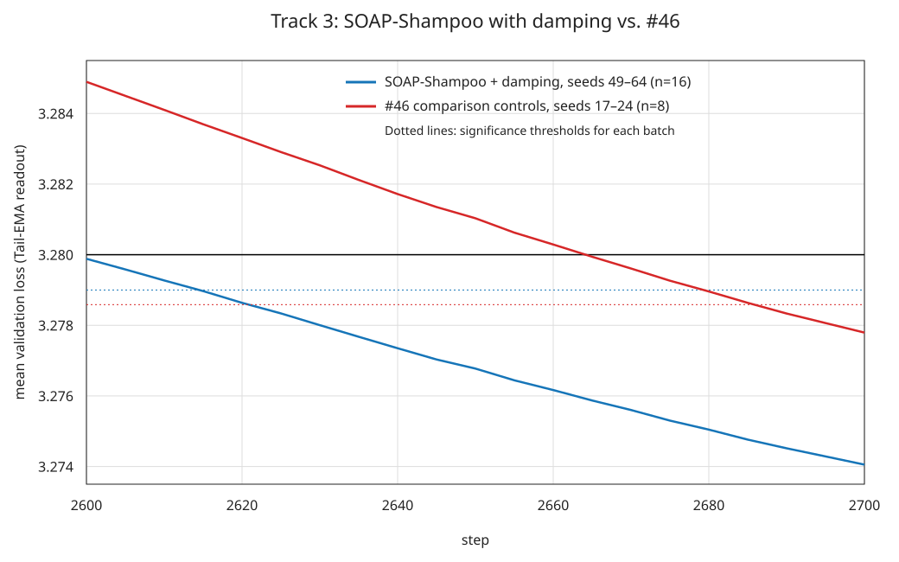

# Track 3 result: SOAP-Shampoo with damping -- 2615 steps (n=16); 2620 steps including tuning runs (n=24)

## TL;DR

Record #46 (PR [#328](https://github.com/KellerJordan/modded-nanogpt/pull/328)) with the **Muon step of its
hidden-matrix optimizer replaced by two-sided temporal-residual Newton-Schulz Shampoo** with a small damping of the
Shampoo factors. SOAP preconditioning and all of #46's update post-processing are kept. Retuned values: the
hidden-matrix LR (0.0375 -> 0.0325) and the Tail-EMA readout (start 2400 -> 2000, tau 150 -> 200).

- **2615 steps** on a 16-seed confirmation batch (49-64): mean val_ema **3.27897**,
  `(3.28 - mean) * sqrt(16) = 0.00412 >= 0.004` (2610 fails at 0.00292).
- Pairwise test against #46 (3.27833 at 2690, n=8): `((3.27833 - 3.27897) + 0.75 * 0.0045) / sqrt(1/8 + 1/16) = 0.0063 >= 0.004`.
- **Disclosure:** 8 earlier runs of the identical configuration (seeds 37-44) were used to choose the damping value.
  Including them (n=24), the first passing step is **2620** (mean 3.27885, 0.00563). Their logs are in
  `tuning_runs_same_config/`.
- Comparison control: #46 rerun (seeds 17-24) passes at **2690** with mean **3.27833**, identical to
  its published result.



## Relation to other Track 3 submissions

This is a SOAP-Shampoo optimization result and an improvement over the accepted #46 baseline (2690 steps),
not a claim to the lowest step count among submitted methods. At the submission review on 2026-10-16,
open PRs reported [2600 steps (#341)](https://github.com/KellerJordan/modded-nanogpt/pull/341),
[2580 steps (#377)](https://github.com/KellerJordan/modded-nanogpt/pull/377), and
[2540 steps (#384)](https://github.com/KellerJordan/modded-nanogpt/pull/384).
These use different optimizer stacks. No statistical-superiority claim against those methods is made here;
the pairwise score above compares only against the supplied #46 controls.

## Method

Per hidden matrix (`q`, `k`, `v`, `attn.proj`, `mlp.fc`, `mlp.proj` in each of the 12 blocks) and step:

1. **Momentum** (replaces Muon's Nesterov momentum): `D = lerp(g, m, beta4)`, `m = lerp(m, g, 1 - beta1)`, and the
   temporal residual `T = debias * D - alpha * g`. `beta1` warms up from 0.85 to 0.95 over 300 steps, as #46's Muon
   momentum does.
2. **SOAP**, unchanged from #46 (Adam in the eigenbasis of EMA(GG^T) / EMA(G^TG), refreshed every step; trust-gated
   on `attn.proj`). The same linear SOAP map is also applied to `T`, so the Shampoo factors are accumulated in the
   space they precondition.
3. **Shampoo instead of Muon's polar step**: `L = EMA_beta2(T T^T)`, `R = EMA_beta2(T^T T)`, damped as
   `L + delta * mean_eig(L) * I` (likewise `R`) with `delta = 0.01`, and `U = L^(-1/4) SOAP(D) R^(-1/4)` computed with
   coupled Newton-Schulz iterations (8 steps, 10 from step 1450). `U` is scaled to Muon's update norm
   `||U||_F = sqrt(rows)`, so #46's LR, u/w floor and CWD keep their meaning.
4. **#46's post-processing**: radial brake, RowFloor, radius pin, post-pin Cautious Weight Decay.

Unchanged from #46: AdamW for the embedding and head, bias-correction-free Adam for gains and biases, EMA-Nesterov,
the PowerCool LR schedule (decay ends at step 2900), initialization, and the Tail-EMA readout (retuned below).

| setting | #46 | this result |
|---|---|---|
| hidden-matrix step | Muon (12-step Newton-Schulz polar factor) | Shampoo `L^(-1/4) X R^(-1/4)` on the SOAP output (`beta2=0.8`, `alpha=0.375`, `beta4=0.9`, damping 0.01) |
| hidden-matrix LR (Muon units) | 0.0375 | **0.0325** |
| Tail-EMA start / tau / lambda | 2400 / 150 / 0.6 | **2000 / 200** / 0.6 |
| run length / LR decay end | evaluated at 2690 / 2900 | 2650 (claim at 2615) / 2900 |

## Result

PyTorch 2.11.0, n = 16 confirmation seeds (49-64), val_ema = validation loss of the
Tail-EMA readout:

| seed | step 2610 | step 2615 | step 2620 | step 2630 |
|---:|---:|---:|---:|---:|
| 49 | 3.28081 | 3.28046 | 3.28015 | 3.27951 |
| 50 | 3.27993 | 3.27963 | 3.27928 | 3.27867 |
| 51 | 3.27811 | 3.27783 | 3.27749 | 3.27684 |
| 52 | 3.27814 | 3.27786 | 3.27750 | 3.27690 |
| 53 | 3.27598 | 3.27568 | 3.27536 | 3.27469 |
| 54 | 3.28257 | 3.28226 | 3.28194 | 3.28127 |
| 55 | 3.27779 | 3.27748 | 3.27716 | 3.27652 |
| 56 | 3.27793 | 3.27761 | 3.27725 | 3.27664 |
| 57 | 3.28047 | 3.28014 | 3.27982 | 3.27924 |
| 58 | 3.27845 | 3.27817 | 3.27782 | 3.27720 |
| 59 | 3.28172 | 3.28142 | 3.28109 | 3.28042 |
| 60 | 3.27901 | 3.27870 | 3.27840 | 3.27772 |
| 61 | 3.27910 | 3.27879 | 3.27848 | 3.27787 |
| 62 | 3.28052 | 3.28024 | 3.27990 | 3.27931 |
| 63 | 3.27951 | 3.27922 | 3.27888 | 3.27825 |
| 64 | 3.27829 | 3.27802 | 3.27766 | 3.27701 |
| **mean** | **3.27927** | **3.27897** | **3.27864** | **3.27800** |
| sd | 0.00167 | 0.00167 | 0.00167 | 0.00167 |
| **(3.28 - mean) * sqrt(16)** | **0.00292** (fail) | **0.00412** (pass) | **0.00545** (pass) | **0.00798** (pass) |

**First-passing step = 2615.** The raw weights (no readout) average 3.28703 at step 2615.

### Disclosure: tuning runs of the same configuration

The damping value was chosen with paired screens. Eight of those runs (seeds 37-44) used exactly this configuration.
They are separate from the confirmation batch. No registration artifact is included, so this submission
does not claim independently documented pre-registration. Both aggregates are reported:

| runs | n | first passing step | mean at that step | `(3.28 - mean) * sqrt(n)` |
|---|---:|---:|---:|---:|
| seeds 49-64 (confirmation batch) | 16 | 2615 | 3.27897 | 0.00412 |
| seeds 37-44 (tuning runs) | 8 | 2635 | - | - |
| all 24 runs | 24 | 2620 | 3.27885 | 0.00563 |

### Exploratory reports: damping

The following tuning comparisons are reports from the supplied experiment write-up. The undamped and
alternative-setting logs are not included, so the paired differences, t-statistics, and attributed step
savings cannot be independently recomputed from this submission. They are exploratory observations;
the submitted evidence establishes the final recipe's aggregate result and its comparison with #46.

Paired against the same recipe without damping on the same seeds (val_ema difference at step 2630; negative is better):

| damping | seeds | mean difference |
|---|---|---:|
| 0.003 | 41-44 | -0.0009 |
| **0.01** | 37-44 | **-0.0013** (6 of 8 better, paired t = -2.1) |
| 0.03 | 41-44 | -0.0010 |

The reported screen favored 0.01 among these values. On fresh seeds, the 16-seed mean at step 2630 is 3.27800 with damping versus
3.27884 for the previous undamped recipe (seeds 17-32). The damping limits how strongly the inverse fourth root
amplifies directions whose eigenvalues lie far below the mean, which matters because the factors are short-memory
EMAs (`beta2 = 0.8`) of low-rank statistics.

With damping on, the neighbouring settings were rechecked on seeds 41-44: LR 0.03 neutral, LR 0.035 worse; Shampoo
`beta2` 0.7 marginally better (about 6 steps, not significant), 0.6 and 0.9 worse; damping 0.02 with `beta2` 0.7 worse.

### Exploratory reports: attribution (same seeds)

`controls_46/` reruns #46's own script for seeds 17-24 and additionally evaluates our Tail-EMA readout
on the same trajectory (evaluation only). Comparing these controls with the undamped version of this recipe on the
same seeds (step 2650, steps converted with the README's 0.0045 per 100 steps): the Shampoo step at its tuned LR
accounts for about 49 steps (paired t = 6.3, better on all 8 seeds), and the readout retune for about 20 steps (#46
with our readout passes at 2675). Damping then adds roughly 20-30 steps (previous section).

### Exploratory reports: settings that did not help

The supplied write-up reports paired screens on one to eight seeds during tuning; the alternative-setting logs
are not included:

- LR decay ending at 2750-2850 or 2950-3000; matrix LR 0.025 / 0.03 / 0.0375 / 0.045; LR decay power 1.5.
- Shampoo `beta2` 0.5 / 0.9 and `alpha` 0 / 0.6 (without damping); Shampoo statistics from the raw residual instead
  of the SOAP output (much worse); 12 final Newton-Schulz steps; per-head block-diagonal factors for attention (worse);
  separate `beta2` for attention or MLP.
- SOAP second-moment exponent 0.25 / 0.75 (worse); Muon on the MLP or on the attention matrices instead of Shampoo
  (worse); attention LR x1.15 (worse) / x0.87 (neutral); `mlp.proj` LR x1.25.
- RowFloor target 0.32 / 0.45, CWD 0.035, EMA-Nesterov lookahead 0.2 / 0.5, head LR 0.004, a momentum cooldown into
  the final 200 steps.
- Other Tail-EMA starts, horizons and blends, including the token embedding, and two-EMA blends.

## Reproducing

Run from the repository root, following the Track 3 quickstart:

```bash
python -m pip install torch==2.11.0 huggingface_hub
python data/cached_fineweb10B.py 20
NPROC_PER_NODE=2 bash records/track_3_optimization/results/20261015_soap_shampoo_damping/run.sh 49
```

The wrapper defaults to two GPUs and seed 49; `NPROC_PER_NODE` supports 1, 2, 4, or 8.
To reproduce the entire claimed batch, run the wrapper once for each seed from 49 through 64.
Logs are written to `logs/` in the repository root. The direct equivalent is:

```bash
torchrun --standalone --nproc_per_node=2 records/track_3_optimization/results/20261015_soap_shampoo_damping/train_gpt_soap_shampoo.py --seed 49
```

All hyperparameters are hardcoded; only `--seed` varies. Dataset, batch size, architecture and validation are those of
`records/track_3_optimization/train_gpt_simple.py`; one forward-backward pass per step; no third-party optimizer
imports.

### Reproduce the exact logged research configuration

The logs embed the research trainer, while `train_gpt_soap_shampoo.py` is a simplified trainer with the
active settings hardcoded. To extract the logged source and prepare a launcher with **every recorded
argument**, run:

```bash
python3 records/track_3_optimization/results/20261015_soap_shampoo_damping/reproduce_log.py records/track_3_optimization/results/20261015_soap_shampoo_damping/seed49_05026440-e173-4c93-81e1-cb37471336de.txt /tmp/soap-shampoo-seed49
NPROC_PER_NODE=2 bash /tmp/soap-shampoo-seed49/run.sh
```

Choose a new output directory: the helper refuses to overwrite an existing one. It only prepares files;
the second command launches training. Repeat with each confirmation logfile to reproduce seeds 49-64.
The output includes the extracted source, its SHA-256, the resolved configuration, and a launcher that runs
from this repository root. No missing configuration values are inferred from research-trainer defaults.
This helper targets the confirmation and tuning research logs; the #46 control logs use their separate trainer.

The recorded runs use `--train-steps 2700 --shampoo-damping 0.01`; the simplified trainer stops at 2650.
Both use schedule endpoint 2900. The research trainer without the recorded flags would use zero damping.
The supplied write-up reports a 40-step comparison of the two trainers on seed 49; those comparison logs
are not included. That check does not establish full-run equivalence. Use the extracted research trainer
and recorded arguments for direct reproduction of the submitted runs.

Hardware names, device metadata, and CUDA build/version details have been removed from filenames,
logs, and logging statements in the embedded and standalone trainers. Numerical results and active
training settings are unchanged.

## Verifying the submitted evidence

From the repository root, run this CPU-only check with Python 3 (no third-party dependencies):

```bash
python3 records/track_3_optimization/results/20261015_soap_shampoo_damping/claim_stats.py
```

It checks the seed sets, duplicate validations, finite losses, and that the embedded training source parses
and is identical within each batch. For the confirmation and tuning batches, it also requires every
research-trainer option to appear in the resolved configuration, checks agreement within and across those
batches, and compares every non-seed value with `expected_config.json`. The control trainer has its
optimizer settings hardcoded in its embedded source and is checked separately. It recomputes the first passing common validation step for the claimed,
tuning, combined and control batches, the raw-weight mean, and the step-adjusted pairwise score.
These checks verify the supplied logs; they do not rerun GPU training or prove the logs' provenance.

## Files

- `train_gpt_soap_shampoo.py`: the submission script.
- `run.sh`: repository-root-aware launcher (defaults: two GPUs, seed 49).
- `claim_stats.py`: dependency-free verification of configurations and log statistics.
- `expected_config.json`: recorded non-seed configuration shared by all 24 SOAP-Shampoo runs.
- `reproduce_log.py`: extracts the logged research trainer and prepares its complete launch command.
- `PR_SUMMARY.md`: prepared pull-request title and description.
- `seed{49..64}_*.txt`: the 16 claimed runs.
- `tuning_runs_same_config/seed{37..44}_*.txt`: the 8 tuning runs of the same configuration (see Disclosure).
- `controls_46/`: #46 rerun (seeds 17-24) with an extra evaluation-only readout, and the script
  used.
- `figure.svg`: mean val_ema of the claimed runs and the supplied #46 controls.
- `make_figure.py`: regenerates the figure from the submitted logs using Python only.

## Credits

- Temporal-residual two-sided Newton-Schulz Shampoo: the submitter's implementation (from their `ShampooAndAdam`
  optimizer).
- Base: #46 by @ypwang61 and its lineage: SOAP-Muon (#14, #16, #44), u/w floor (#9), radial brake and radius pin
  (#29), PowerCool (#20), EMA-Nesterov (#39, #40), Tail-EMA readout (#45), Cautious Weight Decay (Track 3 PR #265;
  [arXiv:2510.12402](https://arxiv.org/abs/2510.12402)).
- Experiments and write-up were done with an AI coding agent.
