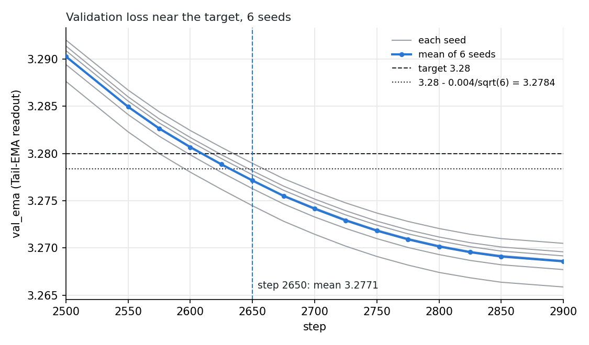

# Track 3: SOAP-Muon + Toner, 2650 steps (-40 vs #46)

## Summary

Adds a Track 3 result for **SOAP-Muon + [Toner](https://mohamad-amin.github.io/blog/toner/)** on top of record #46. Toner measures the second moment
C = E[x xᵀ] of each hidden matrix's input and uses its powers R_q = (C / mean eig(C) + 10⁻³ I)^(−q) on both sides of
the polar step, D = polar(M R_½) R_⅛, with a weight decay shaped by the same statistic. Here #46's SOAP-Muon step runs
in the coordinates of R_½ and its output leaves through R_⅛; the shaped decay is on until #46's EMA-Nesterov lookahead
ends. Everything else is #46's. This reaches val_loss 3.28 in **2650 steps** (n=6), **40 steps
below #46 (2690)**.

## Configuration

| field | value |
|---|---|
| base | record #46, unchanged (SOAP-Muon, RowFloor, radius pin, cautious WD 0.025, EMA-Nesterov, Tail-EMA, all LRs and schedules) |
| Toner inner strength | ½: SOAP-Muon gets M R_½ and G R_½ (SOAP statistics from G R_½) |
| Toner outer strength | ⅛: output O R_⅛, rescaled to ‖O‖_F |
| statistic C | input second moment of each hidden matrix; EMA 0.938; token rows 0–31, then every 16th; all ranks; FP32 |
| roots | R_q = (C / mean eig(C) + 10⁻³ I)^(−q), recomputed every step; no extra forward or backward pass |
| shaped decay | W ← W − 0.08 · lr · Π(W R_⅛² / mean diag(R_⅛²)), Π removes the part along W; steps < 1950 (#46's lookahead end) |

The [blog post](https://mohamad-amin.github.io/blog/toner/) gives the derivation ([§3](https://mohamad-amin.github.io/blog/toner/#s3)) and the shaped decay ([§5.3](https://mohamad-amin.github.io/blog/toner/#s5-4)).

## Reliability

| seed | val_ema (step 2650) | first hit step | logfile |
|---|---|---|---|
| 0 | 3.27628 | 2600 | [H100_seed0_45a2bf7b-4c15-4dd9-9b92-5f1e066c9197.txt](H100_seed0_45a2bf7b-4c15-4dd9-9b92-5f1e066c9197.txt) |
| 1 | 3.27720 | 2625 | [H100_seed1_1da43e4a-8210-44f5-aabb-8b867adabd5a.txt](H100_seed1_1da43e4a-8210-44f5-aabb-8b867adabd5a.txt) |
| 2 | 3.27775 | 2625 | [H100_seed2_1d159502-f367-4f7f-b5f5-d79556947123.txt](H100_seed2_1d159502-f367-4f7f-b5f5-d79556947123.txt) |
| 3 | 3.27896 | 2650 | [H100_seed3_8445788d-185b-444d-a9ba-500834228a89.txt](H100_seed3_8445788d-185b-444d-a9ba-500834228a89.txt) |
| 4 | 3.27817 | 2625 | [H100_seed4_37c257ec-3bec-4bde-87e7-0f333b2bb7fc.txt](H100_seed4_37c257ec-3bec-4bde-87e7-0f333b2bb7fc.txt) |
| 5 | 3.27447 | 2575 | [H100_seed5_3636e351-d10b-4057-b6f8-029d7d268913.txt](H100_seed5_3636e351-d10b-4057-b6f8-029d7d268913.txt) |



mean(val_ema at 2650) = **3.27714**, std = **0.00159**: (3.28 − mean) · √6 = 0.0070 ≥ 0.004.
At step 2625 the mean is 3.27885 (0.0028), so 2650 is the first passing step. Pairwise against
#46 (3.2783, n=8): 0.0055 ≥ 0.004. `val_ema` is #46's Tail-EMA readout. All 6 runs are reported; they
were not early-stopped. Each ran #46's full 2900-step schedule, with evaluations every 25 steps from 2550.

## Reproduce

```bash
torchrun --standalone --nproc_per_node=8 train_gpt_toner.py --seed 0   # seeds 0-5
```

8× H100 80GB, torch 2.11.0, about 239 ms per step.
